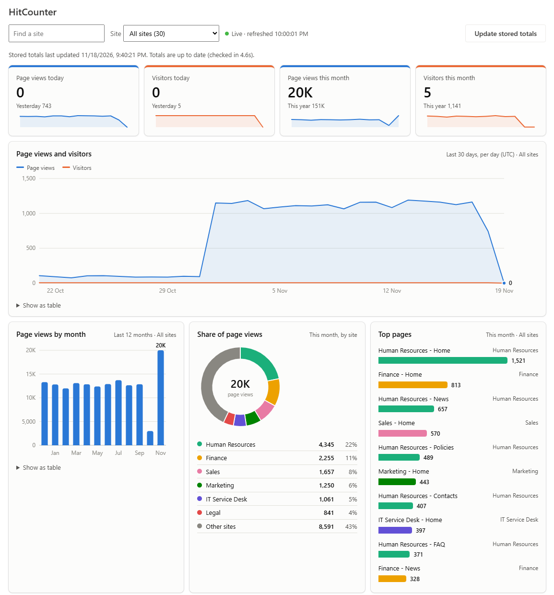
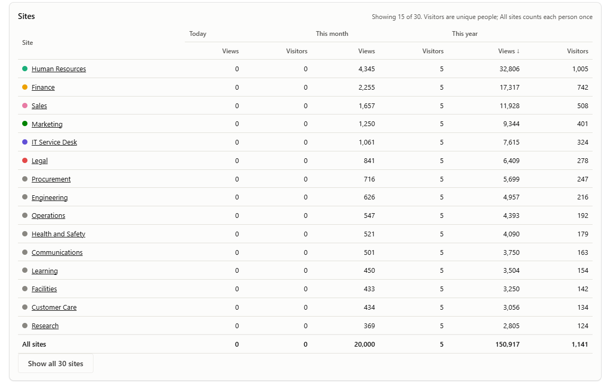

# HitCounter

## Summary

HitCounter counts page views and unique visitors on modern SharePoint pages and keeps the totals **for as long as you want**, in SharePoint lists in your own tenant. SharePoint's built-in site usage page looks back 7, 30 or 90 days; HitCounter keeps daily, monthly and yearly totals per site and for all sites with no time limit, so you can compare this month with the same month last year.

It is one SPFx package with two components:

* **Tracker** (Application Customizer): records each view of a modern page, including in-page (SPA) navigation, as a row in a list on a central site.
* **Dashboard** (web part): sets up the lists, turns the rows into stored totals, and shows them. Central admins see every site and live figures; site owners see only their own sites.

There is no Azure, no scheduler and no external service. Totals are updated in a central admin's browser, when they open the dashboard or in the background while they browse SharePoint.





## Compatibility

| :warning: Important          |
|:---------------------------|
| Every SPFx version is optimally compatible with specific versions of Node.js. In order to be able to Toolchain this sample, you need to ensure that the version of Node on your workstation matches one of the versions listed in this section. This sample will not work on a different version of Node.|
|Refer to <https://aka.ms/spfx-matrix> for more information on SPFx compatibility.   |

This sample is optimally compatible with the following environment configuration:


-Incompatible-red.svg "SharePoint Server 2016 Feature Pack 2 requires SPFx 1.1")


## Applies to

* [SharePoint Framework](https://learn.microsoft.com/sharepoint/dev/spfx/sharepoint-framework-overview)
* [Microsoft 365 tenant](https://learn.microsoft.com/sharepoint/dev/spfx/set-up-your-developer-tenant)

> Get your own free development tenant by subscribing to [Microsoft 365 developer program](http://aka.ms/m365devprogram)

## Contributors

* [Vijay Kumar Gilakattula](https://github.com/gvijaikumar9)

## Version history

Version|Date|Comments
-------|----|--------
1.2.3|November 18, 2026|Initial release

## Prerequisites

* A **SharePoint Administrator** account, to upload the package to the tenant app catalog.
* To upload the package, your account must be a **site admin of the app catalog site**, and the app catalog must **allow custom scripts** for a short while (SharePoint admin center > **Active sites** > the app catalog > **Settings** > **Custom scripts** > **Allowed**; SharePoint switches it back to Blocked within 24 hours). Setting the central site (below) needs the same.
* A site to hold the lists and the dashboard (the **central site**). Its owners become HitCounter's central admins.

## Minimal Path to Awesome

* Clone this repository (or [download this solution as a .ZIP file](https://pnp.github.io/download-partial/?url=https://github.com/pnp/sp-dev-fx-extensions/tree/main/samples/js-application-hitcounter) then unzip it)
* In the command line, from the sample folder, run:
  * `npm install`
  * `gulp bundle --ship`
  * `gulp package-solution --ship`
* Upload `sharepoint/solution/hitcounter.sppkg` to the tenant app catalog. In the trust dialog, leave **Make this solution available to all sites in the organization** unticked for now.
* On the central site, add the app (**Site contents** > **New** > **App** > **HitCounter**), create a page, add the **HitCounter** web part, publish the page, and select **Set up HitCounter**. Set up creates the hidden lists, a library, the **HitCounter Add** permission level and the permissions.
* **One site only:** you're done. The tracker on that site saves its page views to that site's own lists.
* **More sites:** on the dashboard, open **Setup and checks** and select **Make this the central site**. Then either add the app to each site you want to track, or track every site: select **Add to all sites** for HitCounter in the app catalog's **Manage apps**, and check that the **Tenant Wide Extensions** list has an entry for the tracker (component ID `8bbdfbf9-5b59-4175-8dbd-808b48d8a374`, location `ClientSideExtension.ApplicationCustomizer`). If it wasn't added automatically, add it.

A full install guide with screenshots, updating, uninstalling and troubleshooting is in the [HitCounter repository](https://github.com/gvijaikumar9/HitCounter/blob/main/docs/INSTALL.md).

To debug the tracker with `gulp serve`, replace `{tenantDomain}/sites/{pilotSite}` in `config/serve.json` with a page on a site where HitCounter is set up.

## Features

This sample illustrates the following concepts:

* **Tracking in an Application Customizer**, including SPA navigation (`navigatedEvent`), waiting for the page title to update, skipping system pages, edit mode and frames, and de-duplicating repeat views within 30 seconds.
* **Tenant properties** (`SetStorageEntity` / `GetStorageEntity` on the app catalog) as a tenant-wide setting that every site's tracker reads.
* **Tenant-wide deployment** of an extension through `ClientSideInstance.xml` and the Tenant Wide Extensions list, while the same package also works per site (`elements.xml`). A guard prevents double counting when both are active.
* **Locked-down list storage:** a custom permission level, item-level read and write security, broken inheritance, hidden lists excluded from search, created and repaired idempotently from the web part.
* **A summary job that runs in the browser:** a lock with ETag concurrency and server time, per-list cursors so a run can resume, bulk upserts, and handling of 429/503 throttling with `Retry-After`. Lists past 5,000 items are queried on one indexed column at a time.
* **Code splitting:** the summary job is loaded with a dynamic `import()` only for central admins, so other users only download the small tracker.
* **Charts as plain SVG,** with no chart library: KPI sparklines, a line chart with crosshair, columns, a donut and bars, with a colour-blind-safe palette in light and dark themes.
* **Validating untrusted rows:** any internal user can add rows, so IDs, URLs and titles are checked before they are counted, and only `https:` links are rendered.
* **Long-term operation:** reusable monthly lists, a size warning, an archive action, and archive retention to the recycle bin. Stored totals never change.
* **CSV export** of any date range, safe to open in Excel.

## Debug URL for testing

Here's a debug URL for testing around this sample.

```
?loadSPFX=true&debugManifestsFile=https://localhost:4321/temp/manifests.js&customActions={"8bbdfbf9-5b59-4175-8dbd-808b48d8a374":{"location":"ClientSideExtension.ApplicationCustomizer","properties":{"centralSiteUrl":"","debug":true}}}
```

With `debug` set to `true`, the tracker logs each decision to the browser console (filter on `HitCounter`).

## Disclaimer

**THIS CODE IS PROVIDED *AS IS* WITHOUT WARRANTY OF ANY KIND, EITHER EXPRESS OR IMPLIED, INCLUDING ANY IMPLIED WARRANTIES OF FITNESS FOR A PARTICULAR PURPOSE, MERCHANTABILITY, OR NON-INFRINGEMENT.**

## Help

We do not support samples, but this community is always willing to help, and we want to improve these samples. We use GitHub to track issues, which makes it easy for community members to volunteer their time and help resolve issues.

You can try looking at [issues related to this sample](https://github.com/pnp/sp-dev-fx-extensions/issues?q=label%3Ajs-application-hitcounter) to see if anybody else is having the same issues.

You can also try looking at [discussions related to this sample](https://github.com/pnp/sp-dev-fx-extensions/discussions?discussions_q=label%3Ajs-application-hitcounter) and see what the community is saying.

If you encounter any issues while using this sample, [create a new issue](https://github.com/pnp/sp-dev-fx-extensions/issues/new?assignees=&labels=Needs%3A+Triage+%3Amag%3A%2Ctype%3Abug-suspected&template=bug-report.yml&sample=js-application-hitcounter&authors=@gvijaikumar9&title=js-application-hitcounter%20-%20).

For questions regarding this sample, [create a new question](https://github.com/pnp/sp-dev-fx-extensions/issues/new?assignees=&labels=Needs%3A+Triage+%3Amag%3A%2Ctype%3Abug-suspected&template=question.yml&sample=js-application-hitcounter&authors=@gvijaikumar9&title=js-application-hitcounter%20-%20).

Finally, if you have an idea for improvement, [make a suggestion](https://github.com/pnp/sp-dev-fx-extensions/issues/new?assignees=&labels=Needs%3A+Triage+%3Amag%3A%2Ctype%3Abug-suspected&template=suggestion.yml&sample=js-application-hitcounter&authors=@gvijaikumar9&title=js-application-hitcounter%20-%20).


