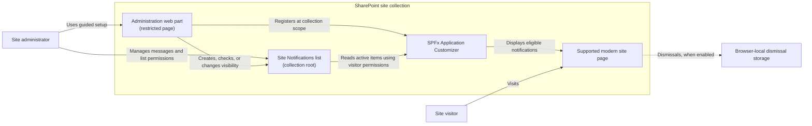
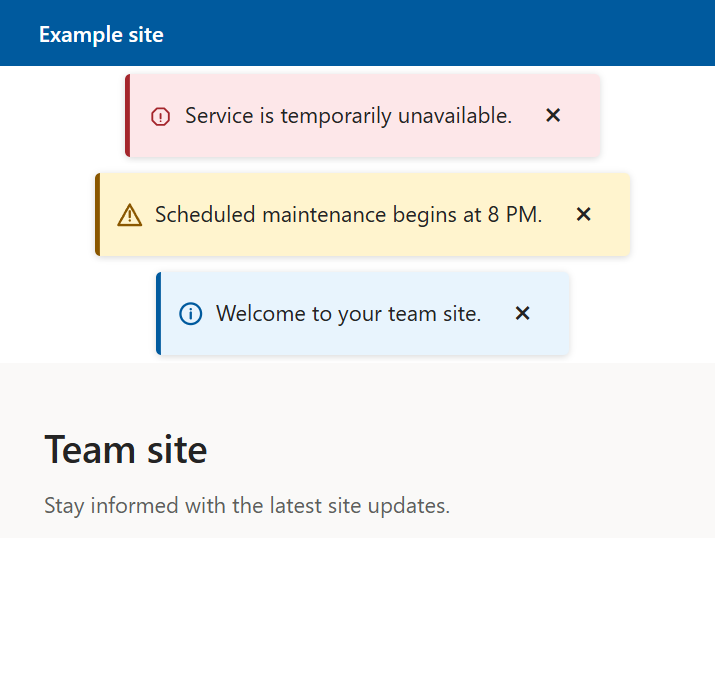
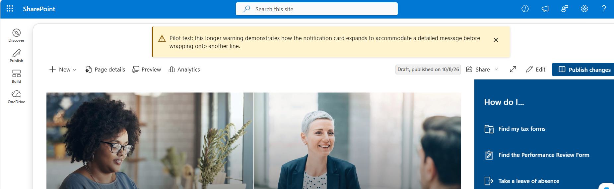
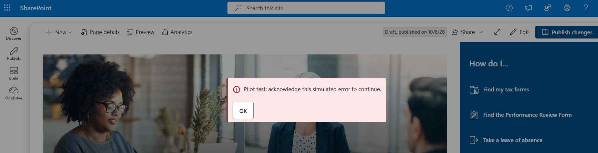
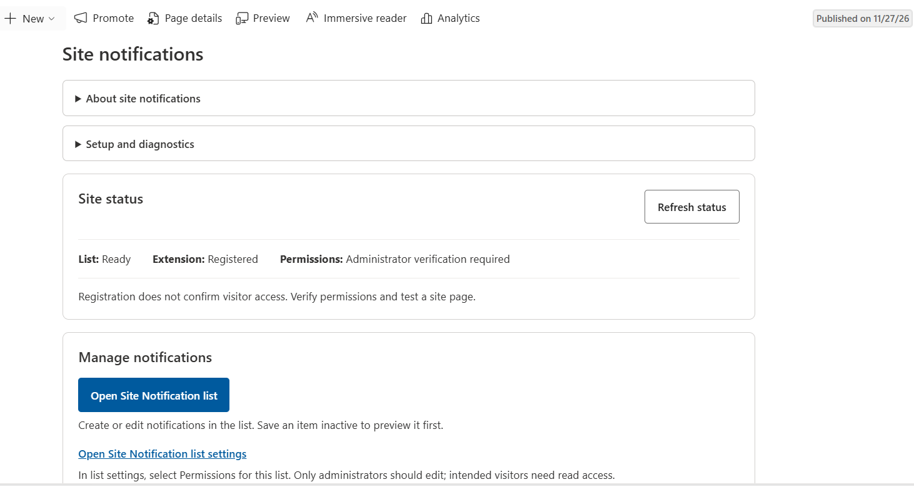
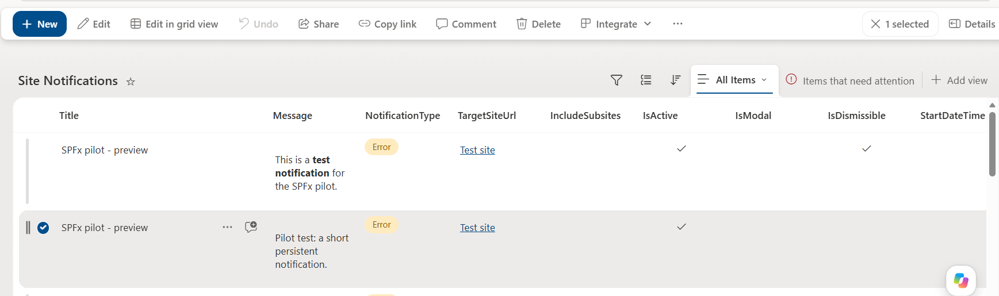

# Site notification banners

## Contributors

- [Vikram Patil](https://github.com/viikrampatil)


## Summary

Give site administrators a way to display notifications, warnings, and errors across supported modern SharePoint Online pages without editing individual pages.

## Applies to

- SharePoint Online
- SharePoint Framework 1.24.2

## Components

- **Site Notification list:** One list per site collection stores messages,
  targeting, schedules, and presentation settings.
- **SPFx Application Customizer:** Reads the list using the visitor's
  permissions and displays eligible notifications.
- **Site Notification Administration web-part:** It provides guided setup, status checks, list visibility controls, previews, and a collapsible guide for administrators. Add this webpart on a Site page and secure the page as needed.

## Architecture



List permissions are configured separately in SharePoint; the web part does not check or change them.

## Notification list schema

The list must be a custom list named **Site Notifications** at
`Lists/SiteNotifications` in the site collection root. Guided setup creates new
lists hidden from **Site contents**; open one using **Open Site Notification list**
on the administration page or a bookmarked list URL. Existing lists retain
their current visibility until an administrator changes it. The web part checks
their schema but does not repair them.

Hidden is a visibility setting, not a security control. Anyone with list access
can still open it directly or through an API, including intended visitors who
need read access to receive notifications. The internal names below must match
exactly, even if display names are changed.

| Column (internal name) | SharePoint type | Required settings and use |
|---|---|---|
| `Title` | Single line of text | Optional; not used by the solution. |
| `Message` | Multiple lines of text, rich text | Required; not append-only. Message must contain 1–500 visible characters after sanitization. |
| `NotificationType` | Choice | Required; exactly `Notification`, `Warning`, `Error`; no fill-in choices. |
| `TargetSiteUrl` | Hyperlink | Required site or subsite URL in this collection; no query or fragment. |
| `IncludeSubsites` | Yes/No | Default No; determines whether nested subsites are included. |
| `IsActive` | Yes/No | Default No; must be indexed. |
| `IsModal` | Yes/No | Default No; Yes starts as a blocking dialog, then becomes a non-modal card. |
| `IsDismissible` | Yes/No | Default Yes; Yes lets the visitor close the card and remember its dismissal. |
| `StartDateTime` | Date and time | Optional start; the notification is eligible from this instant. |
| `EndDateTime` | Date and time | Optional end; if provided with a start, it must be later. |

Enable list versioning. Notification columns must be visible and editable, and
Each item must have values for all four Yes/No fields.

## How notifications work

- Each list item is a notification. Choose **Notification**, **Warning**, or
  **Error** and provide a site URL in the same site collection.
- **Include subsites = No** targets only that site. **Yes** also targets its
  nested subsites. For example, targeting `/sites/Finance/Payroll` with Yes
  includes `Payroll/Benefits`, but not `Finance` or `Payroll2`.
- Only active items within their optional schedule are displayed. Start time is
  inclusive; end time is exclusive. Non-modal cards and the modal queue are
  each ordered Error, Warning, then Notification.
- Notifications appear on supported modern pages; classic pages are not
  covered. Visitors must have read access to the notification list.
- Errors use an octagonal exclamation icon, distinct from the close button.

### Presentation and dismissal

| Modal | Dismissible | Visitor experience |
|---|---|---|
| No | No | A non-modal card remains visible while eligible; there is no close button. |
| No | Yes | A non-modal card can be closed. |
| Yes | No | A modal blocks the page until **OK**, then becomes a non-dismissible card. It returns as a modal on navigation or reload while eligible. |
| Yes | Yes | Closing the modal displays a dismissible card. Closing the card remembers the dismissal in the browser profile. |

Closing a dismissible modal does not dismiss the notification. If its card is
not closed, the modal returns on navigation or reload while eligible.
Dismissals are stored when a dismissible card is closed, in the browser profile
rather than SharePoint. They do not sync across devices, may be shared by users
of the same browser profile, and can be cleared with browser data. A change to
the message or severity makes a dismissed notification appear again on the next
fetch; other edits do not. If storage cannot save a dismissal, the visitor is
informed and the notification may return on navigation or reload.

### Examples

Sample screenshot with example messages on a simulated site page.

**Non-modal notifications:** Error, Warning, and Notification cards with close buttons.



**Warning notification:** A longer message wraps in a dismissible card.



**Persistent modal notification:** An error blocks the page until the visitor
selects **OK**, then remains as a non-dismissible card.



**Administration page:** The web part shows setup status and notification management actions.



**Notification list:** Administrators manage notification items and their settings in SharePoint.



## Build the solution

From this sample folder, using Node.js v26.13.1:

```powershell
npm ci
npm run build
```

The package is created at `sharepoint\solution\spfx-site-banner.sppkg`.

## Deployment

You need a site collection app catalog and permissions to deploy the package, manage the page and list, and register the extension.
If the Site Collection app catalog is unavailable or you lack access, contact your SharePoint administrator. Creating the catalog may require M365 tenant administration.

### 1. Deploy the package

1. In the site collection's root site, open **Site contents** > **Apps for
   SharePoint**. This is the site collection app catalog. If it is unavailable
   or you cannot access it, contact your SharePoint administrator.
2. Build the package locally, then upload it. For an update, replace the existing package.
3. When prompted, make the solution available to all sites and deploy it.
   Confirm that the catalog reports the package as deployed.

When using a site collection app catalog, the availability option applies to
that collection only. Package deployment does **not** register the extension.

### 2. Create the administration page

1. In the root site, open **Site contents** > **Site Pages** (or **Pages**).
   Select **New** > **Page**, choose a template, enter a title *Site-Notification-Admin*, and save the page as a draft.
2. In the pages library, use the page's **Manage access** or advanced
   permissions to restrict it to authorized administrators. Verify that
   intended visitors cannot access it before publishing or using it for setup.
   Saving a draft alone does not restrict it to administrators.
3. Open and edit the restricted page. Add the **Site notification
   administration** web-part, save the page, and publish it if appropriate.

You will use this page and the webpart for guided setup.
Page restrictions do not grant setup permissions. SharePoint authorizes each setup action using the signed-in administrator's permissions.

### 3. Complete guided setup

On the administration page, follow the web part's steps:

1. **Create or check the list.** Check the **List** status. If it says
   **Not found**, select **Create notification list**. Wait for the result
   and correct any reported schema issues before continuing. A new list is
   hidden from **Site contents**; use **Open Site Notification list** or bookmark
   its URL. The web part does not automatically change existing lists; if
   creation fails, inspect the potentially partial list before retrying.
2. **Configure list permissions in SharePoint.** A new list inherits root-site
   permissions. Once the list is found, select **Open Site Notification list
   settings** under **Manage notifications**, then select **Permissions for this
   list**. Restrict editing to authorized administrators and verify read access
   for intended visitors, including subsite users. The web part does not check
   or change permissions. Anyone with read access can also read inactive and
   scheduled items, so messages must not be confidential.
3. **Register the extension.** If registration is missing, confirm the verified
   permissions under **Manage notifications**, then select **Activate Site
   Notifications extension**.
   The confirmation does not verify permissions. Checks cover site-collection
   and root-web registrations, not subsite registrations. Do not run setup
   concurrently in multiple sessions.
4. **Verify.** Select **Refresh status**, then test a site page with an intended
   visitor and, where applicable, a subsite visitor. Registration alone does
   not confirm visitor access or display on every page type.

The collapsible **About site notifications** and **Setup and diagnostics**
sections appear at the top of the admin web part. Once the list and extension
are ready, the creation and activation actions are hidden; **Setup and
diagnostics** remains available. The **Site status**, **Manage notifications**,
and **Preview saved notification** sections organize the main actions.
The list and permissions links open in a new tab. A failed or
inaccessible check is reported as unverified, not as a missing resource.
Links in notification previews also open in a new tab; this does not change
how links in notifications on site pages open.

### Show or hide the notification list

1. On the restricted administration page, find **Notification list visibility**
   under **Manage notifications**. The list must have **List: Ready** status, and its
   visibility must be verified before a button appears.
2. Check whether the list is **Hidden** or **Visible** in Site contents, then
   select **Show in Site Contents** or **Hide from Site Contents** to change it.
   Wait for the result. The action uses your SharePoint permissions and verifies
   the setting after the change. Use **Refresh status** if the result cannot be
   verified before deciding whether to retry.
3. Use **Open Site Notification list** or its bookmarked URL when the list is
   hidden. This setting does not change list permissions or prevent someone
   with access from opening the list directly or through an API. Hiding the list
   does not stop notifications from being displayed to authorized visitors.

## Create and manage a notification

1. On the admin page, select **Open Site Notification list** and create an item.
2. Enter the message, type, target site URL, and presentation options. Use a
   site URL rather than a page URL. Set optional start and end times and leave
   **Active** set to No while reviewing. The internal column names are listed
   in the [schema](#notification-list-schema); display names may differ.
3. Save the item. On the admin page, select **Refresh status**, choose it under
   **Preview saved notification**, and optionally select **Verify target
   site**. Close the preview modal or select **OK** to see its card. Preview
   does not publish or save dismissals; target verification is advisory, uses
   your permissions, and does not verify visitor access.
4. Correct any reported issues, then edit the item and set **Active** to Yes.
   To stop a notification, set it back to No or set an appropriate end time.

The solution allows basic formatting, lists, and HTTP/HTTPS or email links.
Unsupported formatting and unsafe content are removed. A blank or overlong
message and other invalid items are not displayed; review item errors on the
admin page. Changes to items are fetched on page load or SharePoint navigation, not by polling; loaded schedules are re-evaluated at their boundaries.

## Troubleshooting

Start on the administration page and select **Refresh status**. Use the
displayed status and error details to choose the steps below. SharePoint menus
can vary by site and by your permissions.

### List visibility cannot be checked or changed

1. On the administration page, check the **List** status. If it is not
   **Ready**, resolve the reported list issue first; the visibility button is
   unavailable until the list and its visibility have been verified.
2. Select **Refresh status** and read the visibility message. If access is
   denied, ask a SharePoint administrator to check your permissions to the
   notification list and to change its settings.
3. If a visibility change fails or its result cannot be verified, select
   **Refresh status** and check whether the list is now **Hidden** or
   **Visible** before retrying. The change may have succeeded even if its
   verification failed.

### List needs attention or setup was interrupted

1. Note the errors shown under **List needs attention**. Select **Open
   Site Notification list** on the administration page, or open the bookmarked URL.
   For example, append `/Lists/SiteNotifications` to the site collection root
   URL. New lists are hidden from **Site contents**. If setup was interrupted,
   the list may exist even though creation did not finish.
2. Open the list, select **Settings** > **List settings**, and compare its
   columns with the [required schema](#notification-list-schema). Select a
   column to review settings such as its type, required status, choices, and
   default. Display names can differ from internal names; changing a display
   name does not change the internal name.
3. If reported, enable **Versioning settings** > **Create a version each time
   you edit an item**. Under **Indexed columns**, create an index for **Active**
   (`IsActive`) if it is missing. Save each change.
4. Return to the administration page and select **Refresh status**. If a column
   is missing, has the wrong internal name or type, or cannot be corrected in
   list settings, contact your SharePoint administrator or solution support.
   Do not delete or recreate a list or column without reviewing its data,
   permissions, and impact. Guided setup does not repair or overwrite an
   existing list.

If an error says a list named **Site Notifications** exists at a different URL,
check its address and ask your SharePoint administrator to resolve the naming
conflict. The required list is at `Lists/SiteNotifications` under the site
collection root. See Microsoft's [list settings guidance](https://support.microsoft.com/en-us/sharepoint/lists/data-and-lists/edit-list-settings).

### Status says Couldn't verify

1. Read the error beside the list or extension status. Confirm that you are
   signed in to the correct site collection and can open its root site and
   **Site Notifications** list.
2. Check your connection and select **Refresh status**. If the error reports
   HTTP 401 or 403, ask your SharePoint administrator to check your access to
   the list or registration information. For HTTP 429 or 503, wait and retry.
3. If the problem persists, share the status, error, and site collection URL
   with your SharePoint administrator. **Couldn't verify** does not mean the
   list or registration is missing; do not create a replacement based on that
   status alone.

### Extension conflict

Guided setup does not remove or change conflicting registrations. To inspect
them without running a script:

1. On the admin page, expand **Setup and diagnostics** and find **Extension
   registration troubleshooting**. Open **Inspect site-collection
   registrations** and **Inspect root-web registrations**. Both links open
   read-only views in a new tab; the results may appear as JSON or XML.
2. If a result includes a next link, follow it to inspect the remaining
   entries. If access is denied or the result is incomplete, ask your
   SharePoint administrator to inspect it. Subsite registrations are not
   included in these links.
3. In both results, look for entries whose `Name` is `SiteNotificationBanner`
   or whose `ClientSideComponentId` is
   `50e2a56c-f19f-40f5-8d8a-fc4d073da842`. The expected state is **one**
   matching site-collection entry with the exact name `SiteNotificationBanner`,
   location `ClientSideExtension.ApplicationCustomizer`, that component ID,
   and empty or `{}` component properties; there should be **no** matching
   root-web entry. Checks do not cover subsite registrations.
4. Give the relevant entries and the web part's error to your SharePoint
   administrator or solution support for investigation. Do not remove
   registrations blindly: other solutions may depend on them. Once the conflict
   is resolved, select **Refresh status**. If the extension is not registered,
   verify list permissions and use **Activate Site Notifications extension**
   in guided setup.

### Notification is not visible

1. On the administration page, confirm **List: Ready** and **Extension:
   Registered**. If either is not ready, follow the relevant steps above. Confirm
   the package is deployed and available in the site collection app catalog.
2. Select **Open Site Notification list** and open the item. Check that **Active**
   is Yes, the message and other fields are valid, and the optional start and
   end times include the current time. Use the administration page's item
   errors and **Preview saved notification** to help identify problems.
3. Check that **Target site URL** is the site or subsite URL, not a page URL.
   Set **Include subsites** to Yes if the visitor is on a nested subsite.
   Optionally use **Verify target site** on the administration page; it checks
   using your access, not the visitor's.
4. In the root list, open **Settings** > **List settings** > **Permissions for
   this list**. Review inherited or unique permissions and any item-level
   exceptions. Confirm intended visitors can read the list and item, while only
   authorized administrators can edit. Test with an intended visitor account,
   including a subsite visitor where applicable. See Microsoft's
   [list permissions guidance](https://support.microsoft.com/en-us/sharepoint/lists/sharepoint-sharing-and-permissions/customize-permissions-for-a-sharepoint-list-or-library).
5. Test a supported modern site page, not a classic page. A dismissed
   notification may remain hidden in that browser profile; try a separate
   profile with the intended visitor account. Refresh the page or navigate to
   it again after changing the item. If the issue remains, provide the page
   URL, item ID, and observed status to your SharePoint administrator.

Registration alone does not confirm that visitors have access or that a
particular page provides the required placeholder. List readers can also see
inactive and scheduled items, so notifications must not contain confidential
information.

## Compatibility

- SharePoint Online
- SPFx 1.24.2 with the Heft toolchain
- Node.js v26.13.1

## Version history

| Version | Date | Comments |
|---|---|---|
| 2.0.0 | November 2026 | Initial community contribution |

## Disclaimer

This sample is provided as-is, without warranty.

