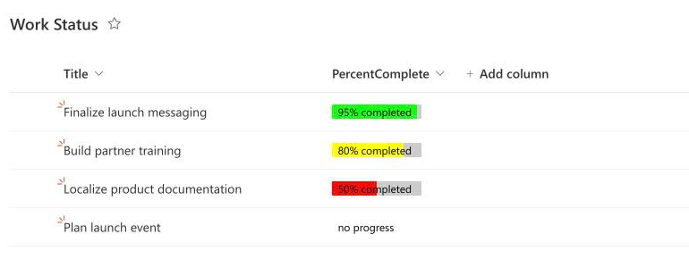

# SPFxFieldCustomizer

Field customizer that shows **PercentComplete** values as colored bars.

This project is the completed solution for the exercise **Create a field customizer extension** in the Microsoft Learn module [Extend the SharePoint user interface with SharePoint Framework extensions](https://learn.microsoft.com/training/modules/sharepoint-spfx-extensions/). For compatibility, prerequisites, and help, see the [tutorial README](../README.md).

## Prerequisites

* A list named **Work Status** with a number column named **PercentComplete**

## Minimal path to awesome

* Clone this repository, or [download this tutorial as a .ZIP file](https://pnp.github.io/download-partial/?url=https://github.com/pnp/sp-dev-fx-extensions/tree/main/tutorials/mslearn-module-extensions) and unzip it.
* From your command line, change to the `tutorials/mslearn-module-extensions/SPFxFieldCustomizer` folder.
* Ensure that you're using a supported Node.js version. If you use nvm, run `nvm use`.
* Set the `SPFX_SERVE_TENANT_DOMAIN` environment variable to your SharePoint Online domain, for example `contoso.sharepoint.com`. If `config/serve.json` contains `<site-name>` or a site path, change it to a site you can test on.
* In the command line, run:
  * `npm install`
  * `npm run start`
* To build a deployable package, run `npm run build`. The package is saved in the `sharepoint/solution` folder.
